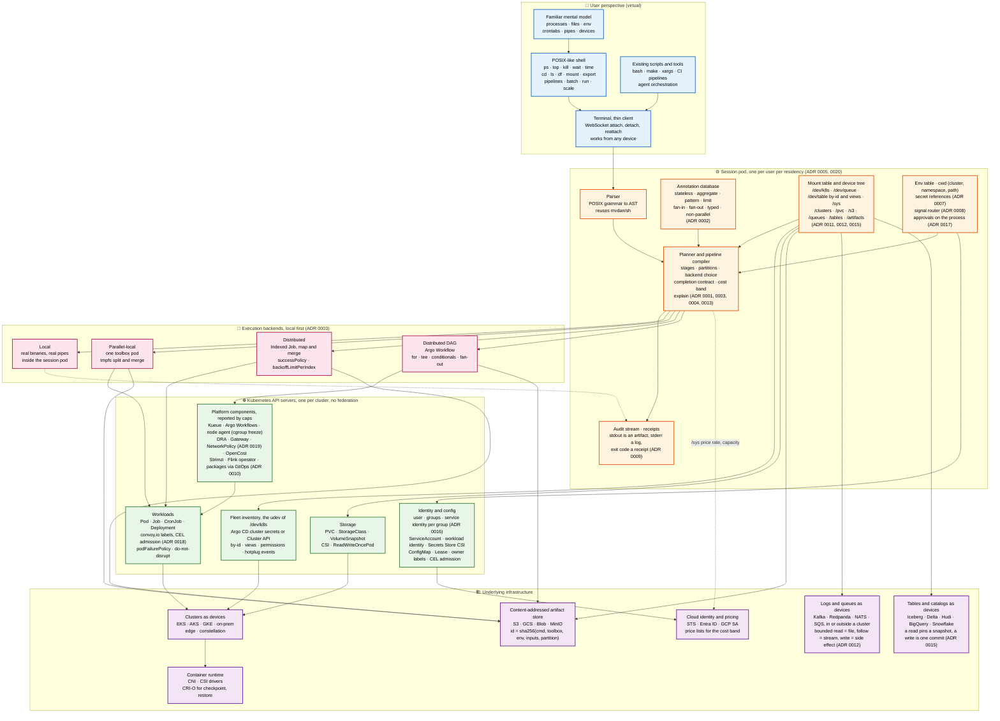

# Convoy Fleet Manager

**A POSIX-like shell whose primitives are Kubernetes objects.** `ps` lists Jobs, Deployments and Workflows as processes. `kill` scales, suspends or freezes them. `batch` queues work through Kueue. A pipeline compiles into a cached, partitioned DAG that runs the real `grep`, `sort` and `awk` over the cluster, without rewriting them.

> **Status: design phase.** This repository holds the architecture, the decisions and the reviewed research. There is no runnable code yet. The first milestone is the toolbox image and the command annotation database; see [ROADMAP.md](ROADMAP.md).

---

## Why

Kubernetes won the infrastructure layer and lost the user interface. Running a thousand copies of a script, training a model on 64 GPUs, or scheduling a nightly Spark job all mean writing YAML, learning a framework's execution model, or both. Machine-learning teams still choose Slurm over Kubernetes for exactly one reason: `sbatch` is a shell command and a PyTorchJob is not.

The shell is the most successful composition interface ever built. Convoy puts it back on top of the cluster that teams already own.

The idea is not new. Plan 9 gave every process its own namespace, Slurm gave batch its verbs, Modal turned functions into containers, Dagger put content-addressed caching under a shell syntax, and PaSh showed how to parallelize unmodified Unix pipelines. Convoy's contribution is combining them on Kubernetes with the leaks named and handled rather than hidden.

## What Convoy is

- **A session.** A server-side object, one per user, that parses commands, plans them, runs small ones itself, and records every command; a controller beside it writes every receipt, so losing the session pod loses only the small commands in flight (ADR 0020). The laptop runs a thin terminal. Disconnecting changes nothing.
- **A planner.** Pipelines, loops and `xargs` compile to a DAG. Each stage runs in one of three backends, in order: locally in the session, in one pod split across cores, or distributed across Indexed Jobs or Argo Workflows. The input size, which is known, decides. The output size, which is not, is never guessed.
- **A toolbox.** One image carrying the real POSIX utilities, a real init, and artifact helpers. Every command carries an annotation that says whether it can run over partitions and how its outputs merge. Unknown commands run on one node, and `explain` says why.
- **A contract.** A process does not exit, it converges or it does not. Every plan carries a best case, a floor, a deadline and a budget. Exit codes are derived from the contract, and a preempted pod never counts as a failure.
- **A ledger.** Cost is a band at dry-run, a column in `ps` at runtime, and a receipt at the end. The receipt is the run history that tightens the next estimate.

## What Convoy is not

- Not a translation of `grep`, `awk` or `sort` into Spark or SQL. The binaries run unchanged; results are identical to Linux by construction.
- Not a stream processor. A pipe is a staged, content-addressed artifact. Streams are opt-in and lose caching, and the planner says so.
- Not a platform-as-a-service. The platform team owns the defaults, the storage classes, the queues and the packages. Convoy makes those defaults visible through `explain`, not invisible.
- Not an emulation of the kernel. `fork`, `ptrace`, shared memory and real-time scheduling do not cross pod boundaries. Where POSIX semantics cannot hold, the difference is surfaced.

## The three definitions

| Term | Convoy definition | Why it matters |
|---|---|---|
| **Pipe** | A staged, typed, content-addressed artifact between two stages. | Reruns skip unchanged stages. A restart downstream loses nothing. |
| **Command** | A verb with a declared class: stateless, aggregate, pattern, limit, fan-in, fan-out, typed, or unknown. | The class is the optimizer's algebra. Without it there is nothing to reason about. |
| **Session** | A server-side process that owns the mount table, the env, the cwd (cluster, namespace, path), and the audit stream. | Every other abstraction stores its state here. |

## A session, end to end

```sh
$ cd /clusters/prod-east/teams/data
$ ls /s3/logs/2026-11/ | wc -l
1648

$ explain 'cat /s3/logs/2026-11/*.log | grep error | awk "{print $1}" | sort | uniq -c | sort -rn | head -n 20'
plan 7f3a…  backend: distributed   input: 412 GiB (1 648 objects)   partitions: 1 648
  stage 1  map     [grep | awk | sort]       stateless+partial   1 648 × 256 MiB   cached: 0
  stage 2  merge   [sort -m | uniq -c]       global order         64-way tree
  stage 3  tail    [sort -rn | head -n 20]   topk_rewrite at stage 1 ✓
exit contract: floor 100 %   deadline: none   budget: none
cost band: $3.10 – $5.40   (compute $2.9–4.8, S3 GET 1 648 × $0.0004)
requires: argo ✓  artifact store ✓  toolbox 1.4 ✓

$ batch --min-success=95% --budget=10 'cat /s3/logs/2026-11/*.log | grep error | … | head -n 20' > top-errors.txt
[5678] queued in team-data (position 2)

$ ps
PID   TYPE      STAGES  PARTS  DONE   COST    STATE
5678  pipeline  3       1648   1203   $2.14   running
5001  training  1       64gpu  -      $412    running (preemptible, ckpt 12 min ago)

$ wait 5678; echo $?
0
$ time 5678
wall 11m02s   cpu 41h12m   partitions 1648 (1648 ok)   cache hits 0   cost $4.31

$ kill -STOP 5001        # cgroup freeze, memory intact, still billed
$ kill 5001              # scale to zero, checkpoint and volumes retained
```

Everything above is specified in [docs/pipeline-compiler.md](docs/pipeline-compiler.md) and [docs/debate-review.md](docs/debate-review.md). None of it runs yet.

## Architecture

The layered view, with the decision record behind each box. [docs/architecture.md](docs/architecture.md) walks through it.



The same picture reduced to the data path of one pipeline:

```
 terminal (thin client)
     │  WebSocket attach
     ▼
 ┌──────────────────────── session pod (one per user) ─────────────────────────┐
 │ parser → AST → planner ─► plan (stages, partitions, backend, contract, cost)│
 │ mount table  /dev /clusters /pvc /s3 /artifacts env table    cwd            │
 │ local backend (real binaries, real pipes)      audit stream  receipts       │
 └───────────┬───────────────────────┬───────────────────────┬─────────────────┘
             │                       │                       │
   parallel-local pod        Indexed Job (map+merge)    Argo Workflow (DAG)
   toolbox image, tmpfs      Kueue queue, podFailure-   fan-out, conditionals,
   PaSh-style split/merge    Policy, floors             multiple merges
             │                       │                       │
             └───────────────────────┴───────────────────────┘
                                     ▼
                  content-addressed artifact store (S3/GCS/MinIO)
                  id = sha256(cmd, toolbox, env, input ids, partition)
```

Platform components Convoy expects and reports through `caps`: an artifact store, Kueue, Argo Workflows, volume snapshots, a GPU device plugin or DRA, a node agent for cgroup freeze, Secrets Store CSI, OpenCost. Each verb declares what it requires, and a missing requirement fails at pre-flight with the capability's name, never at runtime with a Kubernetes error.

## Design principles

1. **Expose emulation, not illusion.** Where semantics differ from Linux, `explain` says so. Nothing is hidden behind a heuristic.
2. **Never decide from a number you do not have.** Input size is known at plan time; output size is not. Plans use the first and never the second.
3. **Local first.** Most commands are small. The fastest backend is the session itself. Pods are an escalation, not a default.
4. **The binary is the semantics.** Text tools run unchanged over partitions. Translation into engine operators is reserved for typed verbs over typed data.
5. **Detach is not destroy.** `umount`, `kill` and `rm` never delete data. Destruction has its own verbs, confirmation, and a snapshot first.
6. **Secrets are references.** A value never reaches the client. Users may use secrets they cannot read.
7. **Preemption is a stop, not a kill.** Disruption never burns retries or floors, and checkpointable processes get the grace period they need.
8. **The platform team owns the defaults.** Storage classes, queues, priority tiers, packages and audit sinks are theirs. Convoy makes them legible.
9. **Cost is part of the contract.** A band at dry-run, a column at runtime, a receipt at the end. The budget binds to the upper bound.
10. **The session is the audit source.** The API server's log is joined to it, not the other way round.

## Repository layout

```
README.md                 this file
ROADMAP.md                build order and milestones
CONTRIBUTING.md           how to propose and review a decision
LICENSE                   Apache-2.0
docs/
  README.md               index of design documents
  pipeline-compiler.md    how |, &&, xargs, for and tee compile; annotations; backends; contract
  debate-review.md        builder review of the nine research takes; cross-cutting decisions
  posix-command-map.md    all 155 POSIX utilities mapped to backing, approach, feasibility, pull
  stories.md              user stories the research missed, and abstractions still to design
  adr/                    architecture decision records
toolbox/
  Dockerfile              toolbox image skeleton (init, coreutils, helpers)
  annotations.yaml        the command annotation database seed
examples/
  *.yaml                  compiled targets from the design docs, validated YAML
research/
  README.md               provenance of the research takes
  notes/                  the AI-generated takes, converted to text, kept for the record
```

## Where the design stands

| Area | State |
|---|---|
| Pipeline compiler, annotation classes, three backends, caching | Specified |
| Completion contract and exit codes | Specified |
| Signals, stdout/stderr, secrets, scheduling, cost, packages | Reviewed and corrected in `debate-review.md` |
| POSIX command map | Complete for the 155 utilities |
| Device tree and mount table | Decided in ADR 0011 |
| Logs and queues as devices (Kafka and relatives) | Drafted in ADR 0012 from a contributed review; a topic has three faces, no streaming backend; an encoded topic is read through its schema with a reader schema pinned at plan time, and text tools see JSON lines or CSV, never raw bytes (decision 10) |
| Native verbs (`explain`, `run`, `wait`, `replay`, unit, device and platform verbs) | Drafted in ADR 0013 as a closed set with one seven-field shape; `explain` is the gate every creating verb passes through; eight register findings close into verb entries |
| Tables and catalogs as devices (Iceberg, Delta, Hudi, warehouses) | Drafted in ADR 0015: a read pins a snapshot so the cache cannot lie, a write is one keyed commit that may replace, warehouses are devices whose reads are priced queries |
| Assisted completion | Drafted in ADR 0014: type-directed completion from the grammar and device tree first; a model may only rank and translate, and the model is a device under `/dev/model` |
| Walkthroughs | Nine workloads exercised in `docs/walkthroughs.md`; ten gaps found, all closed by ADR amendments, flags or fields |
| User-story probes | Thirty-one persona-driven probes in `docs/user-stories/`; 297 findings, 15 structural misroutes; 67 ADR amendments applied and 195 rules written into the ADRs, command map, compiler and roadmap (2026-11-09 to 2026-11-13); 10 open design items, all now drafted (identity in ADR 0016, approvals in 0017, networking in 0019, queue schemas in ADR 0012 decision 10, artifact scrub in ADR 0007 amendment 5, the developer's inner loop in ADR 0022, Terraform as the install phase of every device in ADR 0024, compute beyond Kubernetes in ADR 0025, registries in ADR 0026, notification in ADR 0027), and 24 accepted limitations remain |
| Mount namespace and fileserver | Reviewed, superseding design pending |
| Identity and ownership | Drafted in ADR 0016: a session is a user with groups from the login token, rights and ownership belong to groups, each group has a service identity for unattended work, root is a group assumed with a second member's approval |
| Approvals | Drafted in ADR 0017: an approval is an object on the process created only by a policy gate, it approves a pinned plan hash, it is answered by `approve` or `deny` from another person's session, and the receipt carries it |
| Labels and admission | Drafted in ADR 0018: one `convoy.io/` label set on every object the shell writes, CEL admission as the decision, foreign objects read-only until `chown`, controller keys mapped through `caps` |
| Networking | Drafted in ADR 0019: only a unit has an address, reach is cluster, internal or public with span as a second axis, the owner grants with `--allow` and the caller declares with `--connect`, the platform owns gateways and the default-deny, the session reaches units by port-forward under the user's token |
| Session | Drafted in ADR 0020: the session is a journal in its residency's artifact store and a login with a shell per terminal; the controller writes every receipt, so losing the pod loses only local commands in flight; the client refreshes the token; hosts are designated per residency; no context object (`mount` adds, `cd` switches); `PS1` escapes for mount, namespace, identity mark and device marks from cached state |
| Node health | Drafted in ADR 0021: a fixed catalogue of probes tests GPUs, shared-filesystem clients (EFS, NFS), memory and disks on each node; a fault is attributed to a component, the node or the device by comparing peers; a versioned policy acts on clear cases and a health agent session in the controller judges the ambiguous ones with typed verdicts; a component is excluded before the node, cordons stay within a disruption budget, drain and replacement are approval requests, fencing is never automatic; new nodes are burned in before they take work |
| Infrastructure | Drafted in ADR 0024: Terraform is the install phase of every device. A device package carries a contract and a Terraform module per provider; `mknod` writes a module instance as a pull request, the platform's runner plans and applies, the plan is the `explain` an approval pins, and the outputs register the device; state is a device read under the scrub; moving a device to another provider is a new instance of the same contract |
| Compute beyond Kubernetes | Drafted in ADR 0025: a computer is a device under `/dev/compute/`, and a Kubernetes cluster is one kind beside Slurm, functions, batch services and VM pools; each kind has a driver that fills one contract (stage shapes, states, exit codes, signals, stderr, image formats, bounds, preemption, identity, price model, queue estimate, enforcement, operator, sinks); placement filters every mounted computer by residency, `caps` and bounds, then locality, and ranks by cost and estimated start; there is no federated computer, and regions stay in the path |
| Registries | Drafted in ADR 0026: OCI registries are devices under `/dev/registry/` (registries, pull-through caches, site mirrors, the held registry); repositories are directories, digests are files, tags are symbolic links and signatures, SBOMs, attestations and scans are files beside their digest; every tag is resolved once at plan time and digests are what everything records; `cp` promotes with referrers, nothing in use can be deleted or expired, pulls are as the pod's group, and each cluster reports whether it enforces signatures |
| Notification | Drafted in ADR 0027: Convoy tells a group about its own objects (approval requests, failures, degraded runs, budgets, expiries, disconnections, health actions) through channels the platform already has, as devices under `/dev/notify/`; a group's route maps `page`, `notify` and `digest` to channels and the incident tool keeps the schedules; events roll up per process tree, messages are pointers to objects with no output in them, a failed delivery is itself an event, and Convoy never alerts on telemetry |
| Telemetry | Drafted in ADR 0023: metrics, logs and traces are devices (`/dev/metrics`, `/dev/logs`, `/dev/traces`) over the platform's own stores; a read is a selector path over a required range, cached only when the data is settled; an absent or stale series is `unknown`, never zero; conditions such as `wait --slo` name their query; queries are priced and capped before they run; tenancy and residency are the store's; Convoy never scrapes, alerts or draws |
| Inner loop | Drafted in ADR 0022: the laptop lends a working tree to the session as read-only snapshots over the attach channel, filtered and scrubbed on the laptop; the cluster builds images from snapshots with `image-build` (`provenance: session`, the pool's architectures); a dev unit runs the snapshot in test with `--like` (production's policy), `--follow` (hot reload) and `--debug` (the editor's debugger through `attach -L`); secrets and inbound traffic never reach the laptop |
| Code | None |

## Prior art

PaSh and DiSh (MIT/UPenn), POSH (Stanford), Hadoop Streaming, Plan 9, Slurm, Modal, Dagger, Argo Workflows, Kueue, Nushell, k9s. The design documents cite each where it applies.

## Contributing

Read [CONTRIBUTING.md](CONTRIBUTING.md). The short version: propose changes as decision records, and any claim about Kubernetes behaviour must name the version it holds for.

## License

Apache License 2.0. See [LICENSE](LICENSE).
