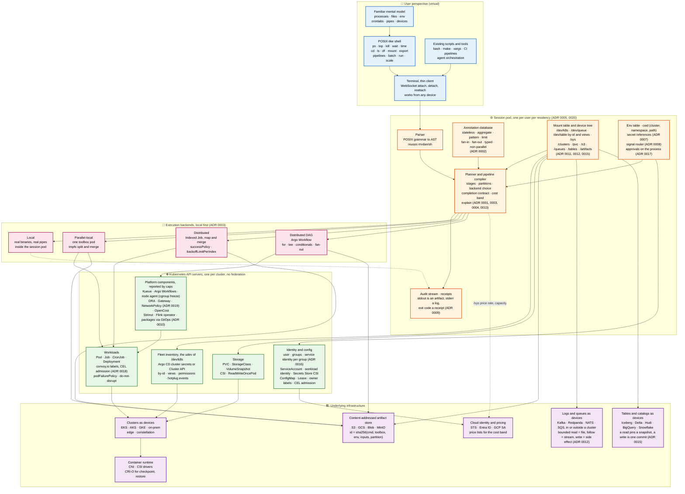

# Architecture, layer by layer

The chart below is the layered view of Convoy. Every box names the decision record that settles it, so a reader can go from a box to the reasoning in one hop. The ASCII sketch in the root `README.md` is the same picture reduced to the data path of one pipeline.

## What changed from the original layered sketch

The first version of this chart, drawn before the design documents, had four layers: user, translation layer, Kubernetes control planes with their "abstracted counterparts", and infrastructure. Five things moved.

| Original box | Now | Why |
|---|---|---|
| Translation layer as a local shell runtime | **Session pod**, one per user, server-side, with a thin terminal client | A laptop sleeping must not kill a pipeline; the audit stream must not be client-controlled ([ADR 0005](adr/0005-session-is-a-server-side-object.md)) |
| Primitive mapper | **Planner** driven by the **annotation database** | A command is not mapped to one object. Its annotation class decides whether it runs locally, in one toolbox pod, or as an Indexed Job, and what the completion contract is ([ADR 0002](adr/0002-commands-carry-annotation-classes.md), [ADR 0003](adr/0003-three-backends-local-first.md)) |
| Pipeline compiler feeding orchestration engines (Argo, Tekton, SparkApplication, Kubeflow) | A separate **execution backends** layer: local, parallel-local, Indexed Job, Argo Workflow | Text tools are never translated to Spark or SQL. Real binaries run over partitions. Spark, Kubeflow and the rest are packages the platform installs, not translation targets ([ADR 0001](adr/0001-pipe-is-a-staged-artifact.md), [ADR 0010](adr/0010-platform-defaults-and-two-package-tiers.md)) |
| Multi-cluster resolver feeding Federation (Karmada, KubeFed) | **Mount table and device tree** talking to one API server per cluster, with the fleet inventory as the udev of `/dev/k8s` | No federation. A cluster is a device, mounted by the session with identity and scope options. `all` is a read-only union ([ADR 0011](adr/0011-device-tree-and-mount-table.md)) |
| Configuration (Secret, ConfigMap) as a counterpart of `export` | **Identity and config**: users and groups from the login token, a service identity per group ([ADR 0016](adr/0016-identity-is-a-user-rights-belong-to-groups.md)), secret references, workload identity, Secrets Store CSI, owner labels | A secret value never reaches the client; users may use secrets they cannot read ([ADR 0007](adr/0007-secrets-are-references.md)) |

Two boxes are new. The **content-addressed artifact store** is the transport of every non-local pipe, so it sits in infrastructure next to the clusters rather than being hidden inside a workflow engine. **Cloud identity and pricing** is where device open performs its token exchange and where the cost band reads its rates.

The **logs and queues** box was added with [ADR 0012](adr/0012-logs-and-queues-are-devices.md): Kafka and its relatives are devices under `/dev/queue`, mounted by the session, whether or not a broker runs inside a cluster. There is deliberately no streaming backend box; a continuous pipeline is a service unit and Flink is a package. The **tables and catalogs** box follows with [ADR 0015](adr/0015-tables-and-catalogs-are-devices.md): lakehouse catalogs and warehouses are devices under `/dev/table`, a read pins a snapshot at plan time, a write is one commit keyed by its input, and a warehouse is never a backend, only a device whose reads are priced queries.

The **planner** box's `explain` is specified in [ADR 0013](adr/0013-native-verbs-have-one-shape.md), which also closes the set of native verbs and gives each the same seven fields. [ADR 0014](adr/0014-assisted-completion-the-model-proposes.md) adds nothing to the chart on purpose: completion is computed in the session from the annotation database and the device tree, and a language model, where one is attached, is one more device class under `/dev/model` in the mount table, not a box of its own.

## Reading the edges

- **Solid edges** are the data and control path of a command: terminal to parser, parser to planner, planner to one of four backends, backends to Kubernetes objects, objects to clusters.
- **Dotted edges** are reads the planner performs before anything runs: capacity and price rate from `/sys`, which produce the cost band in `explain`.
- **Nothing crosses from one API server to another.** Cross-cluster work is two stages with an artifact in the store between them and the egress priced at dry-run.
- **The audit stream is fed by the planner and by the local backend**, not by the API server. The API server's log is joined to the session's stream, never the other way round ([ADR 0009](adr/0009-stdout-artifact-stderr-log.md)).

## What is still missing from the chart

Networking is drafted in [ADR 0019](adr/0019-a-unit-has-an-address-reach-is-a-grant.md): only a unit has an address, the shell writes Services, routes on the platform's Gateways and labelled NetworkPolicy, and the platform owns the gateways and the default-deny, so it stays in the platform box; it is M11 on the [roadmap](../ROADMAP.md). Session placement is drafted in [ADR 0020](adr/0020-a-session-is-a-journal-not-a-pod.md): sessions run on hosts the platform designates per residency, a lost pod is restored from the session's journal, and the controller, not the session, writes receipts; it is M2 on the roadmap, with session hosts in M8. Node health is drafted in [ADR 0021](adr/0021-a-node-is-tested-before-it-is-trusted.md): the probes run with the node agent (M10), and the health agent is a session the controller hosts (M2), so neither adds a box; the platform's own node repairer, where one exists, stays in the platform box and the controller defers to it. The developer's inner loop is drafted in [ADR 0022](adr/0022-the-laptop-lends-a-tree-the-cluster-builds-it.md): the thin client lends a working tree to the session over the attach channel, and builds and dev units run in the cluster, so the laptop stays a terminal and adds no box. Telemetry is drafted in [ADR 0023](adr/0023-telemetry-is-a-device-the-shell-reads.md): metrics, logs and traces are devices over the platform's own stores, read through drivers from packages, so the stores stay in the platform box and Convoy adds no scraper or store. Infrastructure is drafted in [ADR 0024](adr/0024-a-device-is-installed-by-terraform.md): devices are installed by Terraform modules from device packages, applied by the platform's existing runner, so the runner stays in the platform box and the shell only opens pull requests and reads plans, applies and state. Compute beyond Kubernetes is drafted in [ADR 0025](adr/0025-a-computer-is-a-device-kubernetes-is-one-driver.md): the Kubernetes API servers in the diagram are one kind of computer under `/dev/compute/`, beside Slurm clusters, function runtimes, batch services and VM pools, each reached through a driver from a package and installed as ADR 0024 installs every device. Registries are drafted in [ADR 0026](adr/0026-a-registry-is-a-device-a-tag-is-a-name-for-a-digest.md): the platform's OCI registries, caches and site mirrors stay in the platform box and are devices under `/dev/registry/`, read through drivers from packages; the shell resolves tags to digests, copies with referrers and pins what is in use, and admission on each cluster still verifies signatures.
